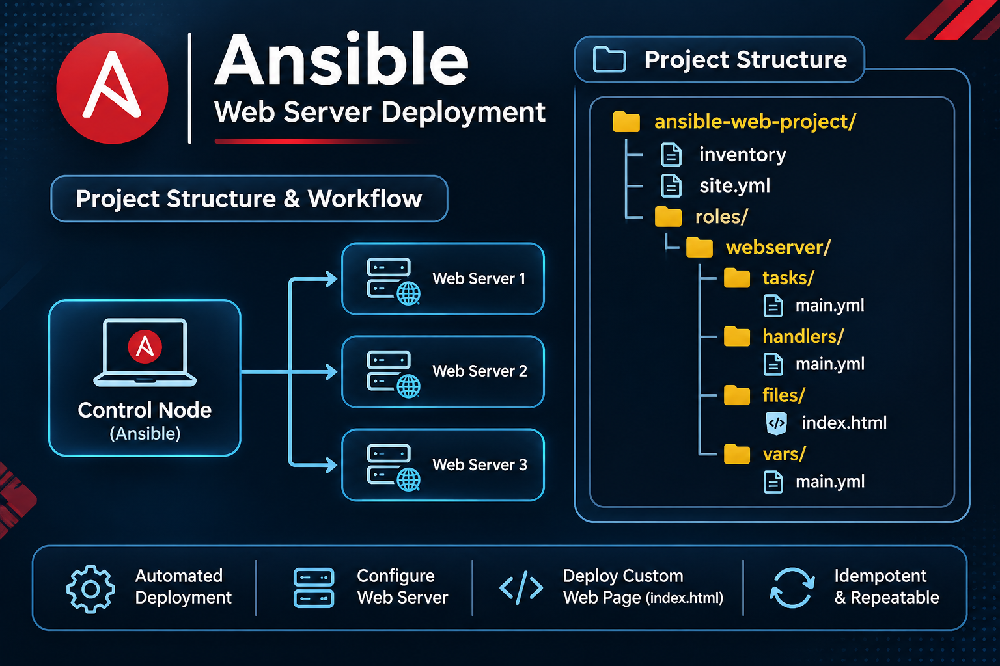

# Ansible Web Server Deployment

Automate web server configuration and custom website deployment across multiple managed servers using **Ansible Playbooks** and a reusable **Ansible Role**.

This repository demonstrates an Ansible control node managing web servers, with tasks, handlers, variables, and website files organized in a role-based project structure.

---

## Architecture & Project Overview



The control node runs the Ansible playbook and connects to the managed web servers over SSH. The `webserver` role configures the web server and deploys the custom `index.html` page.

> The diagram illustrates a three-server example. The actual number of managed hosts is determined by the inventory configuration.

---

## Project Structure

```text
ansible-web-project/
├── inventory/
├── site.yml
└── roles/
    └── webserver/
        ├── tasks/
        │   └── main.yml
        ├── handlers/
        │   └── main.yml
        ├── files/
        │   └── index.html
        └── vars/
            └── main.yml
```

### Directory and file details

| Path | Purpose |
|---|---|
| `inventory/` | Contains the inventory of managed hosts. |
| `site.yml` | Main playbook that applies the webserver role. |
| `roles/webserver/tasks/main.yml` | Tasks to install, configure, and start the web server and deploy the website. |
| `roles/webserver/handlers/main.yml` | Handlers for actions such as restarting or reloading the web server when notified. |
| `roles/webserver/files/index.html` | Static website file copied to the managed server. |
| `roles/webserver/vars/main.yml` | Variables used by the webserver role. |

---

## Workflow

1. Define managed hosts in the inventory.
2. Run `site.yml` from the Ansible control node.
3. Ansible connects to the managed hosts over SSH.
4. The `webserver` role executes its tasks.
5. The web server is installed/configured and the custom `index.html` is deployed.
6. Handlers restart or reload the service when notified by a task.
7. Verify the website using the managed server's IP address or DNS name.

---

## Prerequisites

- Linux Ansible control node.
- Ansible installed on the control node.
- SSH access from the control node to each managed host.
- Python available on managed Linux hosts (as required by the selected modules).
- A valid inventory and SSH authentication.
- Network rules allowing SSH (usually TCP 22) and web traffic (usually TCP 80 or 443).

---

## Install Ansible

### Amazon Linux 2023

```bash
sudo dnf update -y
sudo dnf install ansible-core -y
```

### Ubuntu / Debian

```bash
sudo apt update
sudo apt install ansible -y
```

Verify:

```bash
ansible --version
ansible-playbook --version
```

If your distribution uses a different package manager or repository, follow the official installation guide:
https://docs.ansible.com/ansible/latest/installation_guide/intro_installation.html

---

## Configure Inventory

Add your managed host(s) to the inventory. For example, an INI inventory file:

```ini
[webservers]
WEB_SERVER_1 ansible_user=ec2-user
WEB_SERVER_2 ansible_user=ec2-user
WEB_SERVER_3 ansible_user=ec2-user
```

Replace the example host values and SSH user with the correct values for your environment. If `inventory/` is a directory, place a valid inventory source file inside it.

**Security:** Do not store private SSH keys, passwords, AWS credentials, or access tokens in this repository.

---

## Clone the Repository

```bash
git clone https://github.com/Prince16605/ansible-webserver-automation.git
cd ansible-webserver-automation
```

Update the URL if your GitHub repository uses a different owner or name.

---

## Validate and Run

Test Ansible connectivity:

```bash
ansible all -i inventory -m ping
```

Check playbook syntax:

```bash
ansible-playbook -i inventory site.yml --syntax-check
```

Optional dry run (check mode):

```bash
ansible-playbook -i inventory site.yml --check
```

Run the deployment:

```bash
ansible-playbook -i inventory site.yml
```

If your inventory is a file instead of a directory, use that file path after `-i`.

---

## Verify the Web Server

Check the service on the managed host. Use the service that matches your configured web server:

```bash
sudo systemctl status nginx
```

For Apache on Amazon Linux/RHEL-based systems, the service may be:

```bash
sudo systemctl status httpd
```

Test the website from a machine that can reach the server:

```bash
curl -I http://WEB_SERVER_IP
```

Then visit `http://WEB_SERVER_IP` in a browser. Replace the placeholder with the actual public IP or DNS name. Confirm that the cloud security group and host firewall allow HTTP traffic.

---

## Troubleshooting

| Issue | Checks |
|---|---|
| `ansible-playbook: command not found` | Install Ansible and confirm the executable is available in `PATH`. |
| SSH connection failure | Check host address, SSH username, key, key permissions, and TCP 22 access. |
| Host unreachable | Check routing, firewall rules, security groups, and host availability. |
| Inventory not found | Confirm the inventory path and ensure it contains a valid inventory source. |
| Website does not load | Check web service status, document root, port 80/443 rules, and server logs. |
| Permission denied | Check destination permissions and whether the task needs privilege escalation (`become`). |

---

## Security Best Practices

- Never commit private keys, passwords, tokens, or cloud credentials.
- Prefer IAM roles or securely managed credentials where applicable.
- Restrict SSH access to trusted source IP addresses.
- Use least-privilege access on managed hosts.
- Use Ansible Vault for sensitive variables.
- Review playbook changes before running them against production systems.

---

## Technologies

- Ansible
- YAML
- Linux
- SSH
- Nginx / Apache HTTP Server (depending on role configuration)
- Amazon EC2 (optional deployment environment)

---

## Future Enhancements

- Add separate development, staging, and production inventories.
- Add Ansible Vault for encrypted secrets.
- Use templates and role defaults for reusable configuration.
- Add YAML linting and Ansible syntax checks to CI.
- Add deployment screenshots and test evidence.

---

## Author

**Prince Vaghasiya**

- GitHub: [Prince16605](https://github.com/Prince16605)

---

## License

This project is provided for learning and portfolio demonstration. Add a license file to define reuse and distribution permissions.
