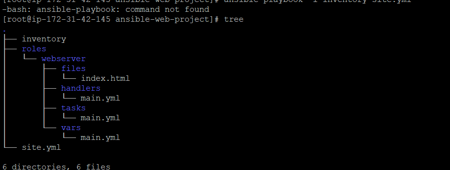

# Ansible Web Server Automation

Automate web server configuration and website deployment using **Ansible Playbooks** and a reusable **Ansible Role**.

This project uses an Ansible role named `webserver` to keep tasks, handlers, variables, and website files organized. The website content is stored in `index.html` and can be deployed to the managed target server(s).

---

## Project Structure

The following image shows the current directory structure of this project:



```text
ansible-web-project/
├── inventory/
├── roles/
│   └── webserver/
│       ├── files/
│       │   └── index.html
│       ├── handlers/
│       │   └── main.yml
│       ├── tasks/
│       │   └── main.yml
│       └── vars/
│           └── main.yml
└── site.yml
```

### Directory and file description

| Path | Purpose |
|---|---|
| `inventory/` | Contains the inventory used to identify target hosts. |
| `roles/webserver/files/` | Stores static files copied to managed hosts, including `index.html`. |
| `roles/webserver/handlers/main.yml` | Defines handlers, such as restarting or reloading the web server after a configuration change. |
| `roles/webserver/tasks/main.yml` | Contains the tasks that install, configure, and start the web server and deploy the website. |
| `roles/webserver/vars/main.yml` | Stores role variables used by the webserver role. |
| `site.yml` | Main playbook that applies the webserver role to the selected hosts. |

---

## How It Works

1. Ansible reads the target hosts from `inventory/`.
2. `site.yml` applies the `webserver` role to those hosts.
3. The role tasks install and configure the web server.
4. The role copies `index.html` from `roles/webserver/files/` to the web server's document root.
5. Handlers can restart or reload the web server when required.
6. You can open the target server's web address in a browser to verify the deployment.

> The exact package name, document root, service name, and target group depend on the values configured in your YAML files and inventory.

---

## Prerequisites

- Linux control node (for example, an Amazon EC2 Linux instance)
- Ansible installed on the control node
- Python available on managed Linux hosts
- SSH connectivity from the control node to managed hosts
- A valid inventory and SSH authentication
- Network/security-group rules that allow the required SSH and HTTP traffic

---

## Installation

### 1. Install Ansible

For Amazon Linux 2023, use the package manager available on your instance:

```bash
sudo dnf update -y
sudo dnf install ansible-core -y
```

For Ubuntu/Debian:

```bash
sudo apt update
sudo apt install ansible -y
```

Check the installation:

```bash
ansible --version
ansible-playbook --version
```

If your Linux distribution uses a different package manager or repository, follow the official Ansible installation guide:
https://docs.ansible.com/ansible/latest/installation_guide/intro_installation.html

### 2. Clone the repository

Replace the URL below with your GitHub repository URL:

```bash
git clone https://github.com/Prince16605/ansible-webserver-automation.git
cd ansible-webserver-automation
```

### 3. Configure the inventory

Add your managed host(s) and connection details to the inventory. For example, an INI inventory file could look like this:

```ini
[webservers]
WEB_SERVER_PUBLIC_IP ansible_user=ec2-user
```

Replace `WEB_SERVER_PUBLIC_IP` with the correct reachable address. Configure SSH key access securely; do not commit private keys to GitHub.

If your inventory is a directory, place a valid inventory file inside it.

### 4. Test connectivity

```bash
ansible all -i inventory -m ping
```

If this command fails, verify the inventory path, SSH username, private-key permissions, network access, and security-group rules.

---

## Run the Playbook

Validate the playbook syntax:

```bash
ansible-playbook -i inventory site.yml --syntax-check
```

Preview the changes where supported:

```bash
ansible-playbook -i inventory site.yml --check
```

Run the deployment:

```bash
ansible-playbook -i inventory site.yml
```

If your inventory is configured as a file rather than a directory, pass that file path with `-i`.

---

## Verify the Deployment

Check the web server service on the managed host. The service name depends on the operating system and web server configured in the role.

Examples:

```bash
sudo systemctl status nginx
```

or:

```bash
sudo systemctl status httpd
```

Test the website from a machine that can reach the server:

```bash
curl -I http://WEB_SERVER_PUBLIC_IP
```

Then open this address in a browser:

```text
http://WEB_SERVER_PUBLIC_IP
```

Replace the placeholder with your managed web server's public IP or DNS name. Ensure HTTP access is allowed by the host firewall and cloud security rules.

---

## Common Troubleshooting

| Problem | What to check |
|---|---|
| `ansible-playbook: command not found` | Install Ansible and confirm it is available in your `PATH`. |
| SSH connection failed | Check the inventory username, SSH key, key permissions, and port 22 access. |
| Host is unreachable | Check the host address, routing, firewall, and security-group rules. |
| Playbook cannot find the inventory | Confirm the inventory path and that it contains a valid inventory source. |
| Website is not loading | Check web server service status, port 80 access, document root, and web server logs. |
| Permission denied while copying files | Check the destination directory permissions and whether the task requires privilege escalation (`become`). |

---

## Security Notes

- Never upload private SSH keys, passwords, access tokens, or AWS credentials.
- Use IAM roles or securely managed credentials where appropriate.
- Restrict SSH access to trusted IP addresses.
- Use least-privilege permissions for managed hosts.
- Review Ansible output before applying changes to production systems.

---

## Technologies Used

- Ansible
- YAML
- Linux
- SSH
- Nginx or Apache HTTP Server (depending on role configuration)
- Amazon EC2 (if using AWS-hosted managed servers)

---

## Future Improvements

- Add separate development, staging, and production inventories.
- Add Ansible Vault for encrypted secrets.
- Add role defaults and templates for easier customization.
- Add handlers for reliable service restarts.
- Add a CI workflow to run YAML linting and Ansible syntax checks.
- Add deployment screenshots and a tested architecture diagram.

---

## Author

**Prince Vaghasiya**

GitHub: [Prince16605](https://github.com/Prince16605)

---

## License

This project is available for learning and portfolio demonstration. Add a license file if you want to define reuse and distribution permissions.
